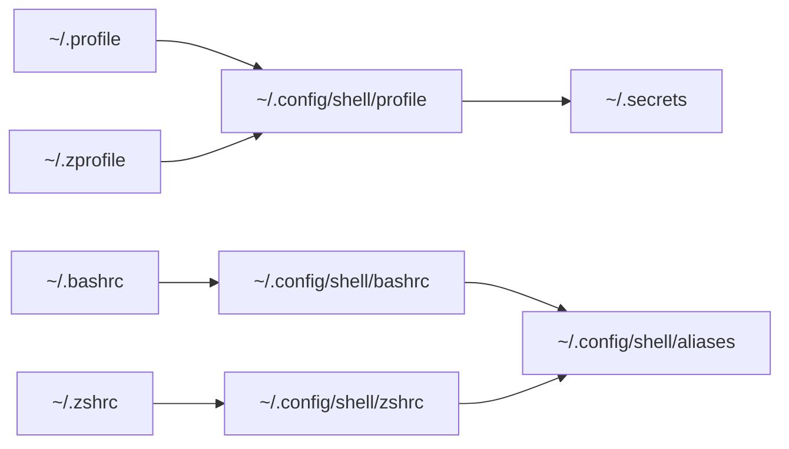

# Dotfiles

Portable configuration managed by [chezmoi](https://www.chezmoi.io/). The repository contains configuration only. It installs no software.

## New machine

Install chezmoi, clone this repository, answer the prompts, and apply:

```sh
sh -c "$(curl -fsLS get.chezmoi.io)" -- init --apply git@github.com:alxfox/dotfiles.git
```

If SSH is not configured yet, use the HTTPS repository URL instead.

The initialization prompt asks for the Git identity and stores it in `~/.config/chezmoi/chezmoi.toml`, which is not committed. To change the answers later, run `chezmoi init --prompt`, inspect with `chezmoi diff`, then run `chezmoi apply`.

The first apply prints optional install commands for zsh, Oh My Zsh, Powerlevel10k, TPM, Claude Code, and Codex. Run the ones the machine needs. Print them again with `install-hints`, or without the shared aliases:

```sh
sh "$(chezmoi source-path)/run_once_after_99-print-install-commands.sh"
```

## Daily workflow

```sh
chezmoi update       # pull and apply changes
chezmoi diff         # preview local changes
chezmoi add ~/.file  # add or refresh a shared file
chezmoi edit ~/.file # edit source and apply it
chezmoi cd           # open the source repository
```

Run `chezmoi apply --dry-run --verbose` before applying a large change.

## Shared and machine-local files

| Local entry point | Managed shared configuration | Local contents |
| --- | --- | --- |
| `~/.profile`, `~/.zprofile` | `~/.config/shell/profile` | PATH entries, tool environment |
| `~/.bashrc`, `~/.zshrc` | `~/.config/shell/bashrc`, `~/.config/shell/zshrc`, `~/.config/shell/aliases` | Tool initialization, installer additions, interactive overrides |
| `~/.gitconfig` | `~/.config/git/config`, `~/.config/git/ignore` | Identity, signing, credential helpers, local overrides |
| `~/.ssh/config.local` | `~/.ssh/config` | Machine-local hosts and overrides |



Edit shared files with `chezmoi edit`. Edit local entry points directly and do not import them with `chezmoi add` or `chezmoi re-add`.

- **Shell**: `profile` and `aliases` are POSIX sh and shared by bash and zsh. `bashrc` and `zshrc` hold the shell-specific history, prompt, and option settings. chezmoi only ensures that each shell entry point contains its `source` line, appending it when missing, and leaves all other lines untouched. Existing distribution files such as Ubuntu's `~/.bashrc` and `~/.profile` are kept. Settings that must override the shared configuration go after the `source` line.
- **zsh**: Oh My Zsh and Powerlevel10k are used when installed, plain zsh otherwise. Generate the local prompt config with `p10k configure`.
- **Git**: Git reads `~/.config/git/config` before `~/.gitconfig`, so local settings win without an include. chezmoi creates `~/.gitconfig` only when absent, seeded from the initialization answers; later changes, including `git config --global`, go to `~/.gitconfig`.
- **SSH**: `~/.ssh/config` includes `~/.ssh/config.local` first. SSH uses the first value found for each option, so local settings win. chezmoi creates `config.local` only when absent. Keys are not managed.

> [!NOTE]
> bash reads `~/.profile` only when neither `~/.bash_profile` nor `~/.bash_login` exists. On machines with one of those files, source `~/.profile` from it.

The tmux configuration keeps the default prefix and keybindings, adding mouse support, a larger history, and `Prefix-R` to reload the file. tmux-resurrect and tmux-continuum restore sessions after a restart when TPM is installed in `~/.tmux/plugins/tpm`; without TPM the plugin lines are ignored. Install the plugins with `Prefix-I`.

Claude Code and Codex share the same global working conventions. Codex reads a symlink at `~/.codex/AGENTS.md` pointing to `~/.claude/CLAUDE.md`.

## Secrets

Keep secrets out of this repository. `~/.secrets` is sourced from `~/.config/shell/profile` when present, and chezmoi enforces owner-only permissions without managing its contents. A password manager integration is preferable for values that need to be shared.

## Upgrading from the `.remote` layout

Earlier versions used `~/.zshrc.remote`, `~/.zprofile.remote`, `~/.zsh_aliases`, and `~/.gitconfig.remote`. `chezmoi apply` deletes these files (listed in `.chezmoiremove`) and rewrites the `.remote` source lines in `~/.zshrc` and `~/.zprofile`. Remaining manual steps:

- Remove the `[include] path = ~/.gitconfig.remote` block from `~/.gitconfig`. Git ignores the missing file until then.
- Remove the `~/.secrets` line from `~/.zprofile`. The shared profile sources it now.
- Delete `~/.oh-my-zsh` and `~/.tmux/plugins` if they are no longer used. They are no longer managed.
